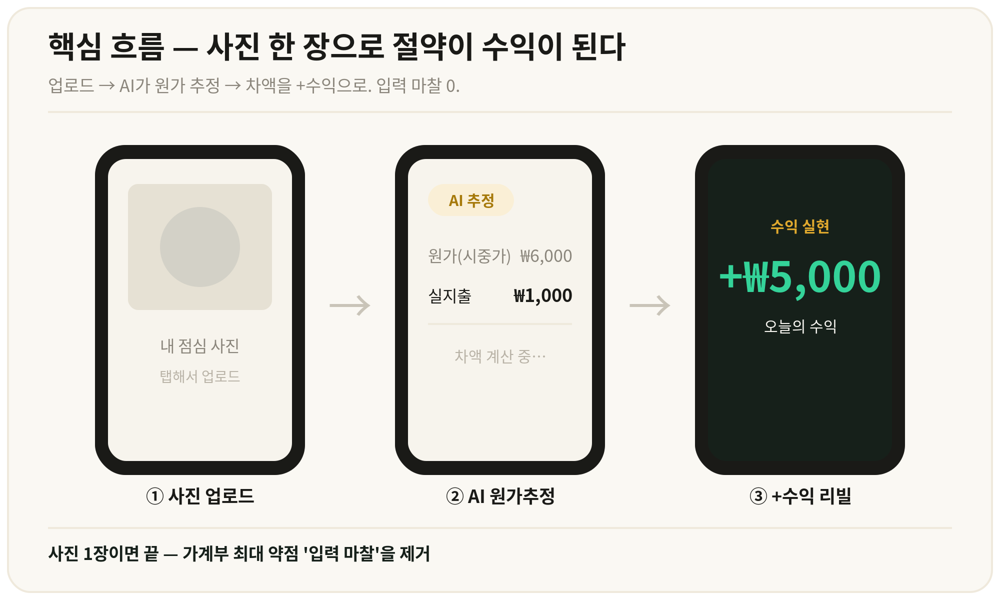
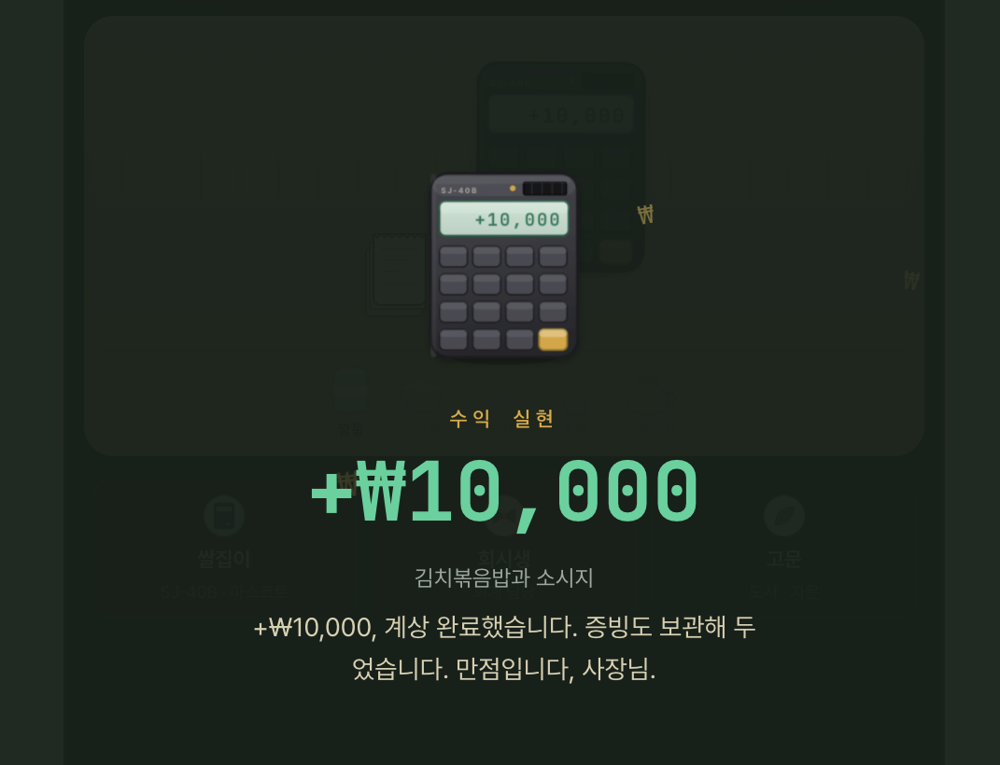

# 거지로그 (geojilog)

[](https://github.com/h6dr-git/geojilog/actions/workflows/ci.yml)    [](LICENSE)

**아낀 돈을 '수익'으로 적는 가계부 웹앱.**
보통 가계부는 쓴 돈만 적는다. 1,000원짜리 학식을 먹으면 지출 1,000원만 남고, 밖에서 먹었으면 나갔을 6,000원과의 차이는 어디에도 기록되지 않는다. 거지로그는 그 차이를 `+₩5,000`으로 적는다.

> 2026년 6월에 만들어 공개했고, 7월에 운영을 내렸다. 지금은 개인용 로컬 실행 경로만 유지한다. 자세한 건 [타임라인](#타임라인)과 [정직한 메모](#정직한-메모) 참고.



## 핵심 흐름

1. **사진 한 장 업로드** — 점심 사진, 영수증, 카드 문자 캡처 아무거나.
2. **AI가 원가(시중가)와 실지출을 추정** — Gemini 비전 모델이 음식·상품을 인식하고, "학식이라 1,000원", "쿠폰 적용" 같은 절약 단서를 찾아 단계별로 분해한다.
3. **차액이 오늘의 수익으로 리빌** — `원가 − 실지출 = +수익`. 사용자는 금액을 고치거나 수익 종류만 고르면 된다.

<p align="center"></p>

## 기능

- **수익 4분류** — 절약형(덜 썼다) · 받음형(얻어먹었다) · 절제형(참았다) · 실수익(알바·용돈). 수익원 문자열로 기본 분류를 추론하고 칩으로 덮어쓴다. (`shared/profitKinds.ts`)
- **장부** — 날짜별 그룹, 상세 시트, 달력, 일괄 편집, 기간별 리포트 카드(공유용 이미지 캡처).
- **AI 분석 파이프라인** — 사진 자동 크롭, EXIF 날짜 추출, 백그라운드 분석 큐, 1인당 하루 30회 상한, 1차 모델 재시도 후 가벼운 모델로 자동 폴백(`server/llm.ts`).
- **원가 추정 정확도 평가** — `scripts/eval-pricing.ts`. 직접 보고 시중가를 매긴 사진 라벨셋(`evalset.labels.json`)으로 직전 커밋 프롬프트(v1)와 현재 프롬프트(v2)를 나란히 돌려 기준가 평균오차·인분 정확도·불변식(`기준가 − Σ절약단계 = 실지출`) 통과율을 비교한다. 라벨셋은 9장으로 작다 — 프롬프트를 바꿀 때 눈대중 대신 쓰는 회귀 검사 정도의 역할이다.
- **카카오 로그인**, **PWA**(홈 화면 설치), **웹 푸시**(저녁 기록 알림), **일일 백업 덤프**, **운영 계기판**(`/ops` — 기록 수·사진 영속성·킬 기준 판정).
- **로컬 복구 모드** — 배포를 내린 뒤 백업 JSON과 원격 DB를 읽기 전용으로 비교해 더 최신 데이터를 로컬 SQLite로 복원하고, 외부 연동(Turso·Kakao·Gemini·푸시)을 전부 끈 채 개인용으로 실행한다. ([LOCAL_RECOVERY.md](LOCAL_RECOVERY.md))

## 기술 스택

| 영역 | 선택 |
|---|---|
| 프론트 | React 19 · Vite 7 · Tailwind v4 · wouter · TanStack Query |
| API | tRPC 11 · Express · Zod 4 · superjson |
| 데이터 | Drizzle ORM · SQLite(로컬) / Turso(libsql, 배포) |
| 인증 | Kakao OAuth · jose(JWT 쿠키) |
| AI | Gemini 2.5 Flash(1차) → Flash-Lite(폴백), OpenAI 호환 엔드포인트 |
| 기타 | web-push(VAPID) · exifr · PWA 서비스워커 |
| 품질 | TypeScript strict · ESLint · Vitest(테스트 17파일·76개) · GitHub Actions(check → lint → test → build) |
| 배포 | Railway(운영 당시) · pnpm · Node 22 |

## 구조

```
client/   React 앱 — pages/(HomeTab 집무실 · Ledger 장부 · Profile), components/, hooks/
server/   Express + tRPC — routers/(savings · ai · auth · incomeSources · reportCards · push · admin …)
          llm.ts(모델 폴백) · prompts.ts(원가추정 시스템 프롬프트) · localMode.ts · backup.ts · opsDashboard.ts
shared/   클라이언트·서버 공용 상수 — profitKinds · incomeSources · ledgerLabels
drizzle/  스키마 · 마이그레이션
scripts/  eval-pricing.ts(정확도 A/B) · restore-local.ts(로컬 복원)
DESIGN.md 디자인 시스템 SSOT(토큰·원칙) — AI 코딩 도구와 사람이 화면을 만들 때 먼저 읽는 파일
```

## 실행

```bash
pnpm install
cp .env.example .env   # 아래 변수 채우기
pnpm dev               # http://localhost:3000
pnpm check && pnpm lint && pnpm test
```

| 변수 | 용도 |
|---|---|
| `GEMINI_API_KEY` | 사진 분석. 없으면 AI 기능만 꺼진 채 동작 |
| `LLM_MODELS` | (선택) 쉼표 구분 모델 목록, 앞이 1차 |
| `DATABASE_URL`, `TURSO_AUTH_TOKEN` | 배포용 libsql. 없으면 로컬 SQLite |
| `KAKAO_REST_API_KEY`, `APP_BASE_URL` | 카카오 로그인·리다이렉트 주소 |
| `JWT_SECRET` | 세션 쿠키 서명 |
| `VAPID_PUBLIC_KEY`, `VAPID_PRIVATE_KEY`, `VAPID_SUBJECT` | 웹 푸시. 없으면 푸시 기능 숨김 |
| `OPS_KEY` | 운영 계기판 `/ops`. 없으면 404 |

로컬 복구 모드(`pnpm dev:local`)는 [LOCAL_RECOVERY.md](LOCAL_RECOVERY.md)를 따른다.

## 타임라인

| 시기 | 일 |
|---|---|
| 2026-05 | 에이전트 플랫폼에서 원형 제작(사진 분석·기록 CRUD) |
| 2026-06-05 | 코드를 독립시켜 이 저장소 시작. Railway·SQLite·Gemini 직통·카카오 로그인으로 교체 |
| 2026-06-08 | Railway 첫 배포 |
| 2026-06-09 ~ 06-15 | 집중 개발 — 10일 동안 커밋 150여 개. 수익 4분류, 장부 개편, 푸시, 백업, /ops, 원가추정 정확도 평가 |
| 2026-06 | 동아리에 알리고 공개. 정식 런칭·베타 모집은 하지 않았다 |
| 2026-07 | 운영 종료(Railway 내림) |
| 2026-09-01 | 로컬 복구 모드 추가 — 남은 기록을 개인용으로 이어 씀 |

## 정직한 메모

- **코드는 AI 코딩 도구가 썼다.** 기능 정의, 우선순위, 검증 기준, 디자인 방향, 출시와 종료는 내가 결정했고, 코드 작성은 AI 에이전트(Claude Cowork, 일부 Cursor)가 했다. 6월 중순 커밋의 `Co-authored-by: Cursor`가 그 흔적 중 하나다.
- **성과라 할 숫자는 없다.** 실제 사용자는 나와 지인 몇 명, 기록은 수십 건. 유용함을 검증하기 전에 운영을 내렸다.
- **얻은 것** — 제품 결정을 기록으로 남기며 한 달을 보낸 경험, 그리고 "쌓인 기록을 내 손으로 분석하지 못한다"는 자각. 그 자각이 데이터 분석 공부로 이어졌다.
- 기획 문서·사업계획서·피드백 노트는 이 공개 저장소에서 뺐다(비공개 저장소에 보관).

## 라이선스

MIT — [LICENSE](LICENSE)
